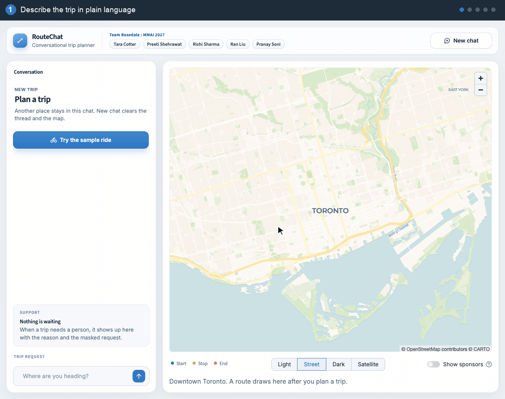
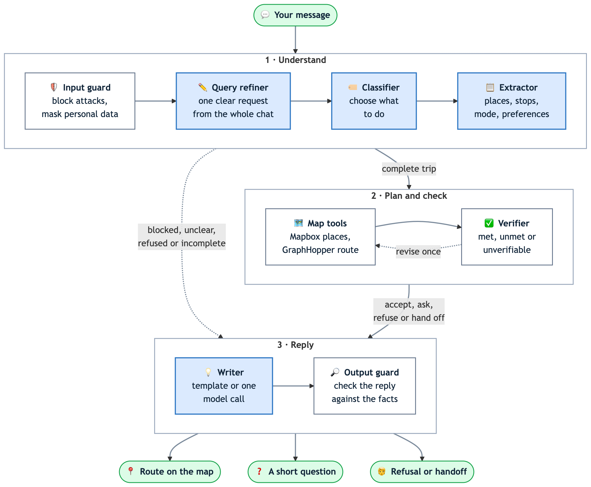

<div align="center">

<h1>&nbsp; RouteChat</h1>

### 🚀 [routechatbot.streamlit.app](https://routechatbot.streamlit.app/)

**Say it your way. Get the route. See it verified.**

[](https://github.com/pranaycv/RouteChatbot/actions/workflows/ci.yml) [](.python-version) [](routechat/graph.py) [](routechat/app.py) [](routechat/maps)

[Take it for a spin](#take-it-for-a-spin) · [How it works](#how-it-works) · [Run it locally](#run-it-locally) · [Data generation](#data-generation) · [Tests and evaluation](#tests-and-evaluation) · [Documentation](#documentation) · [Team](#team)



<br><sub>A real session with a set start point. Typing and waiting are sped up.</sub>

</div>

## Overview

RouteChat is a conversational trip planner. It turns a request such as *"pick up my friend at Markham and Finch, then two stops at Tim Hortons on the way to Blue Mountains"* into a route on a map. It asks when something is missing, and it says plainly what it could and could not confirm.

It was built by Team Rosedale for MMAI 894 (Deep Learning).

### What it does

- **Understands the conversation.** Follow-ups such as *"by car"* or *"make it shorter"* apply to the trip already being planned.
- **Asks only when it has to.** A missing mode, start or destination, or an unclear place name, gets one short question.
- **Checks the route.** Each requirement is marked **met**, **unmet** or **unverifiable**, with the evidence next to it.
- **Takes its facts from map data.** Distances, times and stops come from Mapbox and GraphHopper, and the reply is checked against them before it is shown.
- **Knows its limits.** It refuses requests that are out of scope, and passes a trip to a person when a required condition cannot be met.
- **Protects personal data.** Personal details are masked, and the device location never reaches a language model or the log.
- **Shows the trip your way.** Light, street, dark and satellite maps, with the places and checks below.

Walking, running, cycling and driving are supported, with one mode per trip and up to three required stops.

## Take it for a spin

**Open the live app: [routechatbot.streamlit.app](https://routechatbot.streamlit.app/)**

Nothing to install. Press **Try the sample ride** to see a saved trip without any keys. To plan your own trips, use your own keys:

### 1. Get your keys

You need one key from each row. Sign in to the provider, create the key and copy it.

| Key | What it does | Create it here |
|---|---|---|
| Language model, **either one** | Understands you and writes the reply | [OpenRouter](https://openrouter.ai/settings/keys) or [OpenAI](https://platform.openai.com/api-keys) |
| Mapbox token | Finds the places | [Mapbox access tokens](https://console.mapbox.com/account/access-tokens/) |
| GraphHopper key | Draws the route | [GraphHopper dashboard](https://graphhopper.com/dashboard/) |

Make keys only for this app and set a spending limit on the language model key. Use a Mapbox token with no website restriction.

### 2. Add them to the app

Press **Add your keys**, paste all three, then press **Check and use**. The app checks each one and starts a fresh chat.

### 3. Plan a trip

1. Type where you want to go, with your stops and preferences.
2. Answer if the app asks, for example *"By car"*.
3. Read the route, the places and **What I checked**, then pick a map: **Light**, **Street**, **Dark** or **Satellite**.
4. Change the trip in the same chat, or press **New chat** to start over.

Try one of these:

```text
Plan a bike route from King Station to the University of Toronto with a coffee stop
```

```text
Drive from Union Station in Toronto to Niagara Falls with a stop at Tim Hortons
```

> [!TIP]
> Allow location access when you start from *"my location"*. The app may take a minute to wake up if nobody has used it for a while. Free GraphHopper keys have a limit per minute, so if no route is found, wait a minute and try again.

> [!NOTE]
> Usage is charged to your own accounts. Keys stay in the server's memory for your visit only and are not saved or logged. A refresh or **Remove my keys** clears them. See [how keys are handled](docs/deploy.md#how-keys-are-handled).

## How it works

LangGraph runs eight stages in a fixed order and chooses every branch in Python. A language model reads and writes text. It does not choose the next step, measure the route or decide whether a requirement is met.

<picture>
  <source media="(prefers-color-scheme: dark)" srcset="docs/assets/routechat-flow-dark.png">
  
</picture>

🟦 can call a language model · ⬜ code only · 🟩 what you see

<sub>Flow built with <a href="https://mermaid.js.org/">Mermaid</a> from <a href="docs/assets/routechat-flow.mmd">routechat-flow.mmd</a>. Simplified; <a href="docs/architecture.md">docs/architecture.md</a> has every branch.</sub>

| Stage | Job | Built with |
|---|---|---|
| Input guard | Block attacks and unsupported input, mask personal data | Rules |
| Query refiner (`rewriter.py`) | Turn the conversation into one complete request, shown in the chat as *Refined query* | `gpt-6-luna` |
| Classifier | Write five labels: action (plan, replan, compare, look up, clarify, escalate or refuse), mode, live data, missing place, refusal reason | `gpt-4.1-mini`, or fine-tuned Qwen2.5-1.5B |
| Extractor | Fill a typed `ConstraintSet` | `gpt-4.1-mini` |
| Map tools | Find the places and measure the route | Mapbox, GraphHopper |
| Verifier | Check each requirement, then accept, ask, refuse or hand off | Rules |
| Writer | Write the reply | Templates, `gpt-4.1-mini` |
| Output guard | Compare the reply with the measured facts | Rules |

Models and thresholds are set in [config.yaml](config.yaml).

## Run it locally

You need Python 3.11 and [uv](https://docs.astral.sh/uv/).

```bash
git clone https://github.com/pranaycv/RouteChatbot.git
cd RouteChatbot
uv sync
```

### Try it without keys

Runs the app with a saved sample trip for every request:

```bash
STUBS=1 uv run streamlit run routechat/app.py
```

### Run it with your own keys

```bash
cp .env.example .env
```

Fill in `.env`, then start the app and open <http://localhost:8501>:

```bash
uv run streamlit run routechat/app.py
```

| Variable | Needed for | Where to get it |
|---|---|---|
| `OPENAI_API_KEY` or `OPENROUTER_API_KEY` | Language models | [OpenAI](https://platform.openai.com/api-keys) or [OpenRouter](https://openrouter.ai/settings/keys) |
| `MAPBOX_TOKEN` | Place search | [Mapbox](https://console.mapbox.com/account/access-tokens/) |
| `GRAPHHOPPER_KEY` | Routes | [GraphHopper](https://graphhopper.com/dashboard/) |

`.env` is ignored by git. Never commit a key.

<details>
<summary><b>Optional settings</b></summary>

| Variable | Effect |
|---|---|
| `STUBS=1` | Every stage returns the saved example |
| `FIXTURES=replay` or `record` | Read or save provider responses |
| `CLASSIFIER_BACKEND` | `prompted_small` (default), `prompted_large`, `base` or `ft` |
| `ROUTECHAT_KEYS=visitor` | Shared server: each visitor enters their own keys |

The `base` and `ft` classifiers run locally and need the training libraries. `ft` also needs the fine-tuned adapter, which is not stored in this repository:

```bash
uv sync --group finetune
```

</details>

To put the app online with Streamlit Community Cloud, follow [docs/deploy.md](docs/deploy.md).

### Use it from Python

```python
from routechat.graph import invoke

state = invoke({
    "request_id": "r_0193",
    "utterance": "Plan a bike route from King Station to the University of Toronto",
    "turn_index": 0,
    "known": None,
    "clarify_count": 0,
    "revision_count": 0,
})
print(state["final"])
```

The keys are read from `.env`. Without keys, set `STUBS=1` first to get the saved sample trip.

## Data generation

| Set | Contents | Size |
|---|---|---|
| D1 | Classifier data, one turn with five labels | 1,407 train, 199 validation, 420 test |
| D2 | End-to-end trips with expected constraints, coordinates and outcome | 120 |
| D3 | Adversarial requests in six attack families | 119 |
| D4 | Invented sponsor catalog | 40 |

The data is generated or hand-written by the team, with no real user data. The sets are already in the repository, so you need these steps only to check or remake them.

Check that the test set matches its frozen hash:

```bash
uv run python -m data_gen.pipeline verify
```

Print the quotas the generator aims for:

```bash
uv run python -m data_gen.pipeline plan
```

Try the pipeline with the mock generator. It needs no key, and its output is for testing only:

```bash
uv run python -m data_gen.pipeline generate --n 50 --offline --out data/d1_pilot_trial
```

Generate for real. This needs `OPENROUTER_API_KEY` in `.env`, costs money and stops at a $5 cap. Keep `--out` on a new folder, so the committed files are not replaced:

```bash
uv run python -m data_gen.pipeline generate --n 3000 --out data/d1_pilot_new
```

The output then goes through human review, splitting and freezing. [data_gen/README.md](data_gen/README.md) has those steps, and the ones for D2 to D4.

## Fine-tuning

The `ft` classifier is Qwen2.5-1.5B-Instruct with a LoRA adapter trained on D1. Training needs a GPU, so it runs on a free Kaggle T4 through [finetune/kaggle_train.ipynb](finetune/kaggle_train.ipynb). One run of 3 epochs took about 2 GPU-hours (about $0.69). The adapter is not stored in this repository.

The first two steps need no GPU and no key. They run on any laptop.

Turn D1 into training records. The prompts are the same ones the classifier sends at runtime:

```bash
uv run python finetune/prepare.py --in data/d1/train.jsonl --out finetune/data/train.jsonl
```

```bash
uv run python finetune/prepare.py --in data/d1/val.jsonl --out finetune/data/val.jsonl
```

Check the settings and record counts without training:

```bash
uv run python finetune/train.py --train finetune/data/train.jsonl --val finetune/data/val.jsonl --out finetune/artifacts/run_r16_lr2e-4 --dry-run
```

Train on Kaggle. Import the notebook, choose GPU T4 x1 with Internet on, and click Run All. The notebook clones this repository and runs prepare, train and checkpoint selection. [finetune/README.md](finetune/README.md) has the steps, and how to start it from the command line. When it finishes, download `routechatbot_adapter.zip` and unzip it to `finetune/artifacts/adapter/`.

Run the fine-tuned classifier on your machine. This needs the training libraries:

```bash
uv sync --group finetune
```

```bash
CLASSIFIER_BACKEND=ft uv run streamlit run routechat/app.py
```

Set `CLASSIFIER_ADAPTER_DIR` if the adapter is in another folder. `CLASSIFIER_BACKEND=base` runs the same model without the adapter.

Time the classifier on your laptop (`--device` takes `cpu`, `mps` or `cuda`):

```bash
uv run --group finetune python scripts/classifier_latency_bench.py --device cpu --out eval/results/latency_bench.json
```

The training libraries install on Linux, Windows and Apple Silicon Macs. PyTorch has no build for Intel Macs, so `uv sync --group finetune` fails there. On an Intel Mac, use the prompted classifiers or run the `ft` one on Kaggle.

## Tests and evaluation

<picture>
  <source media="(prefers-color-scheme: dark)" srcset="docs/assets/routechat-quality-dark.png">
  
</picture>

<sub>Built with <a href="https://mermaid.js.org/">Mermaid</a> from <a href="docs/assets/routechat-quality.mmd">routechat-quality.mmd</a>.</sub>

### CI

Every push and pull request runs [.github/workflows/ci.yml](.github/workflows/ci.yml) on GitHub Actions: it installs the locked packages with Python 3.11 and runs the tests. Model and map replies are recorded or scripted, so no key is used and nothing is charged. Run the same tests yourself:

```bash
FIXTURES=replay uv run pytest
```

CI checks the code. It does not score the models, because that needs live calls.

### What is measured

| Set | What runs | What is measured |
|---|---|---|
| D1, 420 messages | The classifier alone, up to four backends | Exact match on all five labels, macro-F1 per label, policy-critical errors, invalid JSON, latency, cost |
| D2, 120 trips | The whole pipeline | Trip success, handoff precision and recall, extractor accuracy per field, latency, cost per successful trip |
| D3, 119 attacks | The whole pipeline | Pass rate per attack family |

A trip succeeds when its outcome is the expected one, every hard requirement of an accepted route is met, and the judge finds no unsupported claim.

- **LLM judge.** `gpt-4.1` answers four yes or no questions about each D2 reply.
- **People.** 50 routes are inspected by hand, and 50 replies are graded by hand to see how far the judge agrees (Cohen's kappa, target 0.6).
- **Cost model.** Cost per request and per successful trip, from the D2 log and the prices in `config.yaml`.

### Run the evaluation

The full run calls the models, Mapbox and GraphHopper, so it needs the keys in `.env` and costs money:

```bash
bash eval/final_run.sh
```

Results are written to `eval/results/`, which git ignores. The `ft` and `base` classifiers also need the training libraries, and `ft` needs the adapter. To run only the prompted ones, set `CLASSIFIER_BACKENDS=prompted_small,prompted_large`.

> [!IMPORTANT]
> Do not score with `FIXTURES=replay` on a fresh clone. The evaluation replies are not recorded in this repository, so every model call fails and the scores mean nothing.

[eval/README.md](eval/README.md) has the metrics, the judge and the cost model in detail.

## Known limits

- **One mode per trip.** Transit, hiking and combined trips are turned away.
- **Typed English requests only.** The voice agent in the first plan is not built.
- **Canada only, for now.** Place search is set by `maps.geocode_country` in `config.yaml`.
- **Preferences are checked, not steered.** The pilot uses GraphHopper's standard routing. If you ask to avoid highways or tolls and the route uses them, the trip goes to a person. Scenic and quiet roads are reported as unverifiable.
- **Opening hours at arrival are not confirmed.** They are always shown as unverifiable.
- **Place matching can be wrong.** A stop may resolve to a similar name nearby, so check the places list.

[docs/scope.md](docs/scope.md) compares the pilot with the first plan.

## Project structure

```text
routechat/        application package
  app.py            Streamlit screen
  graph.py          stage order and every branch
  schemas.py        shared contracts, schemas v1
  agents/           query refiner, extractor, map tools, writer
  classifier/       request classifier and its backends
  guards/           input and output guards
  maps/             Mapbox and GraphHopper clients
  verify/           requirement checks and sponsor rules
data/             D1 classifier data and sponsor catalog
data_gen/         synthetic data pipeline
eval/             metrics, judge, cost model and datasets
finetune/         LoRA training for the classifier
prompts/          versioned prompts and their changelog
policy/           operating policy
report/           study templates and verification notes
docs/             architecture, deployment, semantics
tests/            offline test suite
config.yaml       models, thresholds and prices
```

## Documentation

| Document | Contents |
|---|---|
| [Architecture and contracts](docs/architecture.md) | Stages, branches, plugging in a stage, decisions other packages depend on |
| [Scope notes](docs/scope.md) | What the pilot covers, and what changed from the first plan |
| [Deployment](docs/deploy.md) | Streamlit Community Cloud and visitor keys |
| [ConstraintSet semantics](docs/constraintset_semantics_v1.md) | What each field means |
| [Operating policy](policy/operating_policy.md) | Rules P-01 to P-09 and where they are enforced |
| [Routing verification](report/routing_verification.md) | How map results and checks were validated |
| [Data generation](data_gen/README.md) | D1 to D5 pipeline |
| [Evaluation](eval/README.md) | Metrics, judge and cost model |
| [Prompt changelog](prompts/CHANGELOG.md) | Every prompt change |

## Contributing

1. Branch from `main`: `stage/<name>` for a package, `fix/<name>` for a fix.
2. Keep to the files your package owns. Read [docs/architecture.md](docs/architecture.md) before changing a shared contract.
3. Run `FIXTURES=replay uv run pytest`.
4. Open a pull request. CI runs the same tests.

## Team

**Team Rosedale**, MMAI 2027

Tara Cotter · Preeti Shehrawat · Rishi Sharma · Ran Liu · Pranay Soni

## Acknowledgements

Routing by [GraphHopper](https://www.graphhopper.com/) and place search by [Mapbox](https://www.mapbox.com/). Maps © [OpenStreetMap](https://www.openstreetmap.org/copyright) contributors and © [CARTO](https://carto.com/attributions). Satellite imagery by Esri, Vantor, Earthstar Geographics and the GIS User Community.

**AI assistance:** this project was started with Grok (xAI) and Cursor. Claude (Anthropic) and Codex (OpenAI) were also used. Details are noted in the files.
