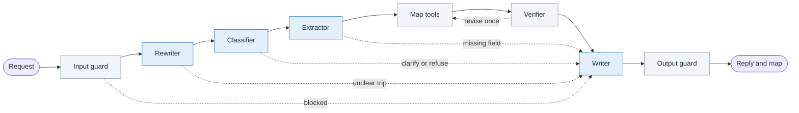

<div align="center">

# RouteChat

**Describe a trip in plain language. Get a real route, with every requirement checked.**

[](https://github.com/pranaycv/RouteChatbot/actions/workflows/ci.yml) [](.python-version) [](routechat/graph.py) [](routechat/app.py) [](routechat/maps)

[Quick start](#quick-start) · [How it works](#how-it-works) · [Evaluation](#evaluation) · [Documentation](#documentation) · [Team](#team)


<br><sub>A real session with a set start point. Typing and waiting are sped up.</sub>

</div>

## Overview

RouteChat is a conversational trip planner. It turns a request such as *"pick up my friend at Markham and Finch, then two stops at Tim Hortons on the way to Blue Mountains"* into a route on a map. It asks when something is missing, and it says plainly what it could and could not confirm.

It was built by Team Rosedale for MMAI 894 (Deep Learning).

### What it does

- **Understands the conversation.** Follow-ups such as *"by car"* or *"make it shorter"* apply to the trip already being planned.
- **Asks only when it has to.** A missing mode, start or destination, or an unclear place name, gets one short question.
- **Checks the route.** Each requirement is marked **met**, **unmet** or **unverifiable**, with the evidence next to it.
- **Takes its facts from map data.** Distances, times and stops come from Mapbox and GraphHopper, and the reply is checked against them before it is shown.
- **Knows its limits.** It refuses requests that are out of scope, and passes a trip to a person when a required condition cannot be met.
- **Protects personal data.** Personal details are masked, and the device location never reaches a language model or the log.
- **Shows the trip your way.** Light, street, dark and satellite maps, with the places and checks below.

Walking, running, cycling and driving are supported, with one mode per trip and up to three required stops.

## How it works

LangGraph runs eight stages in a fixed order and chooses every branch in Python. A language model reads and writes text. It does not choose the next step, measure the route or decide whether a requirement is met.



<br><sub>Blue stages can call a language model. Grey stages are code. The main branches are shown; [docs/architecture.md](docs/architecture.md) has all of them.</sub>

| Stage | Job | Built with |
|---|---|---|
| Input guard | Block attacks and unsupported input, mask personal data | Rules |
| Rewriter | Turn the conversation into one complete request | `gpt-6-luna` |
| Classifier | Choose plan, replan, compare, look up, clarify, escalate or refuse | `gpt-4.1-mini`, or fine-tuned Qwen2.5-1.5B |
| Extractor | Fill a typed `ConstraintSet` | `gpt-4.1-mini` |
| Map tools | Find the places and measure the route | Mapbox, GraphHopper |
| Verifier | Check each requirement, then accept, ask, refuse or hand off | Rules |
| Writer | Write the reply | Templates, `gpt-4.1-mini` |
| Output guard | Compare the reply with the measured facts | Rules |

Models and thresholds are set in [config.yaml](config.yaml).

## Quick start

You need Python 3.11 and [uv](https://docs.astral.sh/uv/).

```bash
git clone https://github.com/pranaycv/RouteChatbot.git
cd RouteChatbot
uv sync
```

### Try it without keys

Runs the app with a saved sample trip for every request:

```bash
STUBS=1 uv run streamlit run routechat/app.py
```

### Run it with your own keys

```bash
cp .env.example .env
```

Fill in `.env`, then start the app and open <http://localhost:8501>:

```bash
uv run streamlit run routechat/app.py
```

| Variable | Needed for | Where to get it |
|---|---|---|
| `OPENAI_API_KEY` or `OPENROUTER_API_KEY` | Language models | [OpenAI](https://platform.openai.com/api-keys) or [OpenRouter](https://openrouter.ai/settings/keys) |
| `MAPBOX_TOKEN` | Place search | [Mapbox](https://console.mapbox.com/account/access-tokens/) |
| `GRAPHHOPPER_KEY` | Routes | [GraphHopper](https://graphhopper.com/dashboard/) |

`.env` is ignored by git. Never commit a key.

<details>
<summary><b>Optional settings</b></summary>

| Variable | Effect |
|---|---|
| `STUBS=1` | Every stage returns the saved example |
| `FIXTURES=replay` or `record` | Read or save provider responses |
| `CLASSIFIER_BACKEND` | `prompted_small` (default), `prompted_large`, `base` or `ft` |
| `ROUTECHAT_KEYS=visitor` | Shared server: each visitor enters their own keys |

The `base` and `ft` classifiers run locally and need the training libraries. `ft` also needs the fine-tuned adapter, which is not stored in this repository:

```bash
uv sync --group finetune
```

</details>

To put the app online with Streamlit Community Cloud, follow [docs/deploy.md](docs/deploy.md).

### Use it from Python

```python
from routechat.graph import invoke

state = invoke({
    "request_id": "r_0193",
    "utterance": "Plan a bike route from King Station to the University of Toronto",
    "turn_index": 0,
    "known": None,
    "clarify_count": 0,
    "revision_count": 0,
})
print(state["final"])
```

Set `STUBS=1`, or the keys above in the environment, first. The app reads `.env` by itself; this call does not.

## Evaluation

| Set | Contents | Size |
|---|---|---|
| D1 | Classifier data, one turn with five labels | 1,407 train, 199 validation, 420 test |
| D2 | End-to-end trips with expected constraints, coordinates and outcome | 120 |
| D3 | Adversarial requests in six attack families | 119 |
| D4 | Invented sponsor catalog | 40 |

The data is generated or hand-written by the team, with no real user data. [data_gen/README.md](data_gen/README.md) explains how it was made and how the test set is protected.

Run the tests offline with recorded responses. No key is used and nothing is charged:

```bash
FIXTURES=replay uv run pytest
```

Run the evaluation:

```bash
FIXTURES=replay uv run python -m eval.run_eval --all
```

Steps whose inputs are not available print `waiting for ...`. The final run calls the live providers and is started with `bash eval/final_run.sh`. [eval/README.md](eval/README.md) lists the metrics, the judge and the cost model.

## Known limits

- **One mode per trip.** Transit, hiking and combined trips are turned away.
- **Canada only, for now.** Place search is set by `maps.geocode_country` in `config.yaml`.
- **Preferences are checked, not steered.** The pilot uses GraphHopper's standard routing. If you ask to avoid highways or tolls and the route uses them, the trip goes to a person. Scenic and quiet roads are reported as unverifiable.
- **Opening hours at arrival are not confirmed.** They are always shown as unverifiable.
- **Place matching can be wrong.** A stop may resolve to a similar name nearby, so check the places list.

## Project structure

```text
routechat/        application package
  app.py            Streamlit screen
  graph.py          stage order and every branch
  schemas.py        shared contracts, schemas v1
  agents/           rewriter, extractor, map tools, writer
  classifier/       request classifier and its backends
  guards/           input and output guards
  maps/             Mapbox and GraphHopper clients
  verify/           requirement checks and sponsor rules
data/             D1 classifier data and sponsor catalog
data_gen/         synthetic data pipeline
eval/             metrics, judge, cost model and datasets
finetune/         LoRA training for the classifier
prompts/          versioned prompts and their changelog
policy/           operating policy
report/           study templates and verification notes
docs/             architecture, deployment, semantics
tests/            offline test suite
config.yaml       models, thresholds and prices
```

## Documentation

| Document | Contents |
|---|---|
| [Architecture and contracts](docs/architecture.md) | Stages, branches, plugging in a stage, decisions other packages depend on |
| [Deployment](docs/deploy.md) | Streamlit Community Cloud and visitor keys |
| [ConstraintSet semantics](docs/constraintset_semantics_v1.md) | What each field means |
| [Operating policy](policy/operating_policy.md) | Rules P-01 to P-09 and where they are enforced |
| [Routing verification](report/routing_verification.md) | How map results and checks were validated |
| [Data generation](data_gen/README.md) | D1 to D5 pipeline |
| [Evaluation](eval/README.md) | Metrics, judge and cost model |
| [Prompt changelog](prompts/CHANGELOG.md) | Every prompt change |

## Contributing

1. Branch from `main`: `stage/<name>` for a package, `fix/<name>` for a fix.
2. Keep to the files your package owns. Read [docs/architecture.md](docs/architecture.md) before changing a shared contract.
3. Run `FIXTURES=replay uv run pytest`.
4. Open a pull request. CI runs the same tests.

## Team

**Team Rosedale**, MMAI 2027

Tara Cotter · Preeti Shehrawat · Rishi Sharma · Ran Liu · Pranay Soni

## Acknowledgements

Routing by [GraphHopper](https://www.graphhopper.com/) and place search by [Mapbox](https://www.mapbox.com/). Maps © [OpenStreetMap](https://www.openstreetmap.org/copyright) contributors and © [CARTO](https://carto.com/attributions). Satellite imagery by Esri, Vantor, Earthstar Geographics and the GIS User Community.

Parts of this project were written with AI assistance, as noted in the files.
